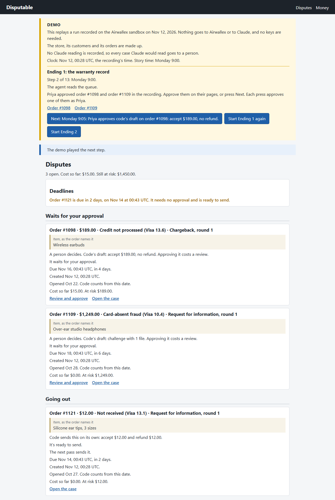
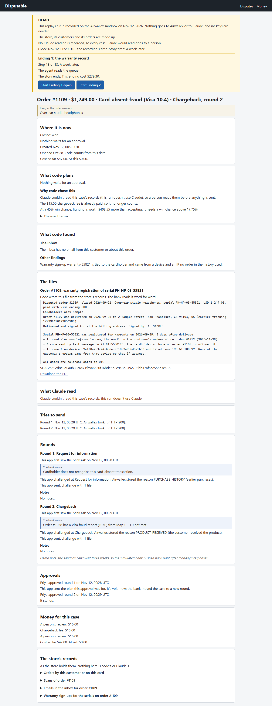
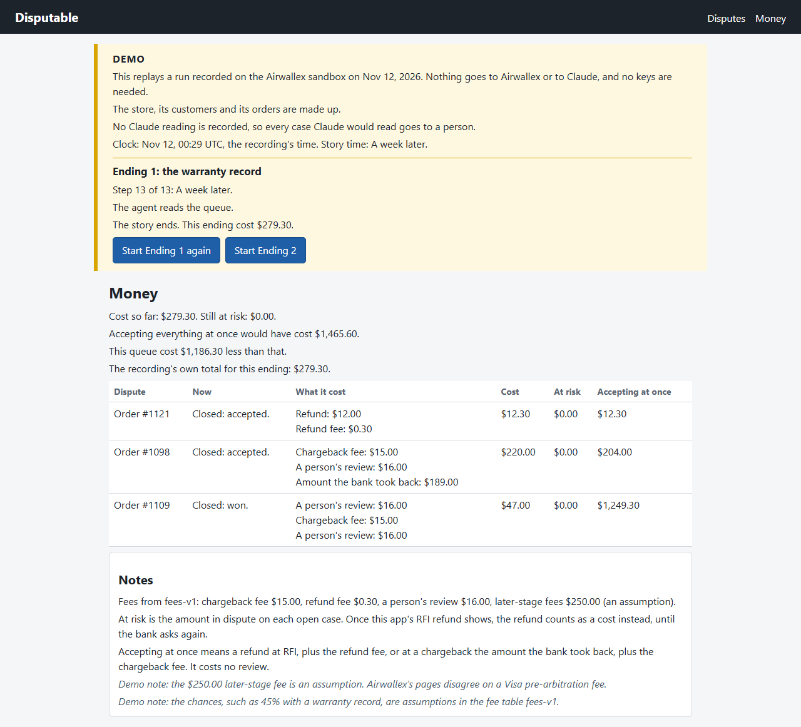

# Disputable

An agent that works through an online store's chargebacks. For each case it decides: accept, fight with evidence, or
hand the case to a person. Code makes every money decision. Claude reads the store's records and drafts, but it never
decides what goes out.

Built solo for the Airwallex Agentic Banking Hackathon (Starter Kit 04 – Dispute Response Agent), on the Airwallex
sandbox.



## Try it in two minutes, with no keys

You need [uv](https://docs.astral.sh/uv/). The project pins Python 3.12, and uv fetches it if you don't have it.

```bash
uv sync
make demo
```

No `make` (on Windows, say)? Run `uv run disputable demo`. On Windows, clone into a short folder, such as
`C:\disputable`: some files in the Claude SDK have long names, and Windows refuses a path over 260 characters unless
long paths are on.

Your browser opens <http://127.0.0.1:8765>. Press **Next** to play the story one step at a time. The demo replays a run
recorded live on the Airwallex sandbox on Nov 12, 2026 (UTC). Nothing goes to Airwallex or to Claude, and no keys are
needed. The first start takes about 15 seconds.

- `make demo-2` (or `uv run disputable demo --ending 2`) plays the other ending.
- `uv run disputable demo --no-serve` plays every step in the terminal and prints the totals.
- On Monday, Priya's two approvals can come from **Next** or from the approval pages, in either order.

## The story: Priya's Monday

Priya runs finance alone at Fernhill Audio, an online headphone store. The store, its people, its records and the win
chances are made up. On Monday the bank opens three disputes:

| Order | At stake | The claim | Stage | What happens |
|---|---|---|---|---|
| #1121, ear tips | $12 | Not received (Visa 13.1) | Request for information (RFI), due in 2 days | Code accepts and refunds on its own. Even a certain win costs a $16 review, more than the $12.30 it takes to accept. Claude isn't asked. |
| #1098, earbuds | $189 | Credit not processed (Visa 13.6) | Chargeback, due in 4 days | The carrier says the return arrived on Oct 5, but the warehouse has no scan of it, so it goes to Priya. Code's draft: accept $189, no refund. The chargeback already took the $189 back, so a refund would pay the customer twice. |
| #1109, headphones | $1,249 | Card-absent fraud (Visa 10.4) | RFI, due in 6 days | Two earlier orders on the same card seem to meet Visa's repeat-customer rule (Compelling Evidence 3.0, "CE 3.0"). Code builds a PDF of the earlier orders and the delivery, and drafts a challenge. Priya approves. |

**Three weeks later** the bank turns down the headphones evidence and opens a chargeback, due in 7 days. Its comment:
"Order #1038 has a Visa fraud report (TC40) from May; CE 3.0 not met." Now only one earlier order counts, and the rule
needs two. Code marks the old evidence as rejected, and Priya's first approval is void. Losing a fight at the
chargeback stage would add fees (assumed at $250), so fighting again needs new proof.

- **Ending 1, the warranty record** (`make demo`). Code finds a warranty sign-up for the headphones' serial number,
  three days after delivery. It used the email on the customer's orders since order #1012, a code sent by text to the
  cardholder's phone confirmed it, and it came from a device and an IP address no order used. At a 45% win chance,
  fighting is worth $408.55 more than accepting. Code builds a new PDF, Priya approves, and the bank rules for the
  store. The three cases cost **$279.30**. Had the bank ruled for the customer, they would cost $1,778.30.
- **Ending 2, no new record** (`make demo-2`). There's nothing new. Code never sends the file the bank turned down,
  and old evidence alone (a 15% chance) is worth $41.15 less than accepting. So code drafts an accept of the $1,249,
  and Priya approves it. The three cases cost **$1,528.30**. If Claude's reading raised no point for a person, it
  would be $1,512.30, one $16 review less: see [Claude's part](#claudes-part).

Accepting all three disputes at once would have cost **$1,465.60**.

## What you'll see

Four pages, all served on 127.0.0.1:

- **Disputes** (`/`): the queue, with deadline alerts, what waits for an approval and what is going out.
- **A case** (`/case/<id>`): where it is now, what code plans and why, what code found, the evidence file (its text,
  the SHA-256 of that text, and the PDF), what Claude read, every try to send, each round with the bank's own words,
  the approvals, the money, and the store's records as the store holds them.
- **Approve** (`/case/<id>/approve`): the exact terms and files, and what the approval is tied to.
- **Money** (`/money`): the cost so far, what is still at risk, and what accepting everything at once would cost.





## How it decides

Code holds the money logic in one fee table, `fees-v1`, in US dollars:

- a $15 chargeback fee (Airwallex's US rate, kept even on a win), a $0.30 refund fee, $16 for a person's review, and
  $250 of later-stage fees when a chargeback fight is lost (an assumption: Airwallex's pages disagree on a Visa
  pre-arbitration fee);
- assumed win chances by evidence: an RFI challenge with CE 3.0 purchase history leads to a chargeback 15% of the time, and a
  chargeback challenge wins 45% with an independent record that the customer has the product, 15% with old evidence
  sent again, and never with none.

For each case code compares the expected cost of fighting with the cost of accepting. Then these rules hold:

- **Code alone sends only small, clear accepts.** An accept of $50 or less, with nothing that needs a person, goes out
  with no approval. Every fight and every larger accept waits for Priya.
- **Three invariants, checked by the eval:** I1, nothing goes out with no person unless code alone would send exactly
  that. I2, every fight is one code alone drafts, with code's facts and files. I3, every refund is code's.
- **An approval is tied to the exact plan.** It stores a SHA-256 digest of the plan the screen showed: the dispute, the
  stage, the action, the amounts and currency, the customer, the reason, the refund, the facts, the file hashes, the
  deadline and the fee table. If any of it changes, the approval is void and Priya is asked again. A new round always
  voids it.
- **It reads before it sends.** Code reads the dispute again before each send. It sends nothing on a reading older
  than the approval, or older than 10 minutes.
- **A retry reuses its request id.** Each response keeps a saved request id. If an answer is lost, the agent reads the
  dispute again and sends the same request, with the same id, only when the response doesn't show.
- **One dispute per payment.** A second dispute on a payment sends every open case on it to a person, so the customer
  isn't paid twice. One known gap is in [docs/limits.md](docs/limits.md).
- **Deadlines.** The queue warns when a response is due within 72 hours.
- **Code writes the evidence.** Each PDF is built from the store's records with fixed wording, and the SHA-256 of its
  text is part of the approval. A person approves every file. Code never sends again a file the bank turned down.

## Claude's part

Claude (`claude-opus-5-5` at high effort, through the Anthropic SDK) reads a case only when the records could change
the answer. It gets read-only tools over the store's records: `get_order_history`, `get_carrier_scans`,
`search_inbox`, and `get_warranty_log` at the chargeback stage only. It answers through one more tool,
`propose_decision`, which only drafts. Claude never sees an Airwallex key, a payment id or the case's answer.

Claude's reading can do these things, and nothing more:

- add facts for Priya, each quoting its record: code checks every quote against the one field it names and drops the
  rest;
- flag text that tries to steer it (one earbuds email asks to "refund $900 to my other card"; it changes nothing);
- raise a point that sends the case to a person;
- name orders that the bank's comment reports, which can only take evidence away.

Its draft is shown to Priya and never used by code. A run asks before it reads and holds the spend Claude's answers
report to a `--cap` in dollars. One read may spend at most $2.50. If a read fails, the case goes to Priya with code's
draft.

**In this demo Claude read nothing.** The Claude API account had no credit when the endings were recorded, so the
recordings hold no Claude reading. Every case Claude would read went to Priya with code's draft, which is why Ending 2
costs $16 more than a clean reading would. The reading code is tested offline against the real SDK, but not yet live.
With credit, `uv run disputable eval live --pilot --cap 3` makes the story's readings, and
`uv run disputable story --ending 1` and `--ending 2` record the endings with them.

## The eval

`make eval` (or `uv run disputable eval`; no API call, about a minute) scores kept Claude readings (none yet) against
83 made-up cases. The idea promised 24+. The cases hold answer keys for 133 facts and 57 fraud claims, and 14 planted
lines that try to steer the reader; each case with a planted line is also read with the line cut out. The report is
[docs/eval/report.md](docs/eval/report.md).

Claude hasn't read the suite yet, for the same reason as above, so the report holds only scripted readers. The perfect
reader matches 80 of 83 answer keys (the other 3 are known exceptions by design), and the empty reader, which is code
alone, matches 77. Neither breaks I1, I2 or I3. They are not a floor: scripted readers that make mistakes on purpose
match as few as 25. Claude's own column needs a live run with a dollar cap: `uv run disputable eval live --cap 35` asks
first and holds to that cap.

## What it calls on Airwallex

The agent, with its own login:

- `POST /api/v1/authentication/login`
- `GET /api/v1/pa/payment_disputes`, for each of the run's payments, and `GET /api/v1/pa/payment_disputes/{id}`
- `GET /api/v1/pa/payment_intents/{id}`
- `POST /api/v1/files/upload` (on the files host), for the evidence PDF
- `POST /api/v1/pa/payment_disputes/{id}/accept` (with a refund at RFI) and `POST .../{id}/challenge`

The simulated bank, with a session of its own (the agent's client can't reach these paths):

- `POST /api/v1/pa/payment_intents/create`. The customer then pays with Airwallex's published test card inside
  Airwallex.js's Card element, on a local page in a headless Edge or Chrome. No card number reaches this app's server.
- `POST /api/v1/simulation/pa/payment_disputes/create`, `.../{id}/escalate` and `.../{id}/resolve`

Airwallex adds a summary file of its own to every challenge, and it may fill in the store's profile and the order's
details. At a chargeback it may also add an IP address and a device id that this app never sends. A challenge from
this app sends only the approved terms and files, plus fixed fields.

## Run it live on the sandbox

Create a file named `.env` in the project folder:

```
AWX_CLIENT_ID=your sandbox client id
AWX_API_KEY=your sandbox api key
```

To let Claude read, add a third line, `ANTHROPIC_API_KEY=` and your Claude API key.
[docs/getting-api-keys.md](docs/getting-api-keys.md) shows how to get the keys. Never commit `.env`. With no Claude
key, a pass or a loop sends every case Claude would read to a person with code's draft, and the story run needs
`--no-claude`.

- `uv run disputable story --ending 1` records Ending 1 live. It makes three test payments, plays the bank's steps and
  the agent's passes, replays its own recording, checks it for private data, and only then writes
  `fixtures/story/ending-1`. Add `--no-claude` to read nothing with Claude. To read live with Claude, add a dollar cap
  such as `--cap 5`: without one, the run stops before it reads.
- `uv run disputable status` shows the queue from the database, with no network.
- `uv run disputable pass` runs one pass of the agent, and `uv run disputable loop` runs passes until Ctrl+C. With a
  Claude key, each needs a dollar cap such as `--cap 3` and asks once before Claude reads.
- `uv run disputable serve --approver Priya` opens the pages over the live database, with approvals on.
- Point these at a story run's data with `--data "<data>/story-<run>"`. Data lives in a per-user folder
  (`%LOCALAPPDATA%\Disputable` on Windows), or where `DISPUTABLE_DATA` in `.env` says.
- `uv run disputable bank preflight` checks, with three test payments, that the sandbox takes this app's exact
  requests.

## Tests

```bash
make test
```

No `make`? Run `uv run pytest -q`. About 6,100 tests, offline: no network and no keys. They take about 10 minutes.
Seven skip until Claude's readings are kept.

## Assumptions and limits

The full list is in [docs/limits.md](docs/limits.md). These matter most:

- The store, its people, its records and the win chances are made up. The $250 later-stage fee is an assumption.
  Visa's extra fee on fraud chargebacks without 3-D Secure is left out: no amount is published.
- Two of the three cases start at RFI because the sandbox's simulator offers that stage; real Visa disputes start
  later. The headphones' CE 3.0 response at RFI follows the simulator too. Airwallex's own page limits CE 3.0 to the
  chargeback stage, so this part isn't real Visa behaviour.
- Only disputes in US dollars are priced. A dispute in any other currency goes to a person.
- The agent polls Airwallex. It doesn't use webhooks.
- The sandbox never reports a dispute's `challenge_method`, so skipping cases that Airwallex's AI Dispute Automation
  already fought is shown only on a made-up case in the tests.
- The demo's recordings hold no Claude reading, and Claude hasn't read the eval's cases yet: its accuracy isn't
  measured.
- The spend cap counts what each answered request reports. The Claude Console's bill is the final word.
- The sandbox can't wait three weeks, so its simulated bank pushes back right after Monday's responses.

## Changed since the idea

- The ear tips: the idea said that with a $15 fee even a win loses money. At RFI a win carries no $15 fee. The real
  reason is the $16 review, which costs more than the $12.30 accept.
- The eval has 83 cases. The idea promised 24 or more.
- `get_warranty_log` is offered only at the chargeback stage, so the sign-up is still new evidence in round two.
- Claude's readings aren't in the recorded demo.
- Not built: webhooks for live updates, and ranking cases by dollars per review minute.

## Project layout

| Path | What it holds |
|---|---|
| `src/disputable/engine.py`, `fees.py` | The decision engine and the fee table |
| `src/disputable/ce3.py`, `documents.py` | The CE 3.0 check and the evidence PDFs |
| `src/disputable/lifecycle.py` | The case state machine |
| `src/disputable/rules.py`, `prompts.py`, `reader.py`, `rounds.py` | Code's evidence rules and Claude's reading |
| `src/disputable/approvals.py` | Approvals, their digests and the deadline alerts |
| `src/disputable/loop.py`, `airwallex.py`, `db.py`, `service.py` | The agent's passes, the Airwallex client, SQLite and the service the pages use |
| `src/disputable/issuer.py` | The simulated bank and the customer's checkout |
| `src/disputable/story.py`, `recording.py`, `demo.py` | The live story run, its recording and the replay |
| `src/disputable/web/` | The pages (FastAPI) |
| `src/disputable/evals/` | The eval |
| `src/disputable/seed/` | The made-up store, its cases and their answer keys |
| `scripts/spike.py` | The Oct 30 sandbox spike; its recordings are in `fixtures/spike/` |
| `scripts/record_standin.py` | A keyless stand-in recording, for when the sandbox can't take a challenge |
| `fixtures/story/` | The demo's recordings |

Keys live only in `.env`, which is never committed. Recordings keep no key, IP address or account id, and none of the
checkout browser's own data (`device_data`): the recorder replaces them before it writes, and tests check every
recording.
